# Stylised Facts of Stock Returns: 50 Years of Coca-Cola (KO)

[](../../actions/workflows/tests.yml)
[](../../actions/workflows/analysis.yml)


Do the textbook "stylised facts" of financial returns hold for a large, stable, blue-chip stock?
This project tests all eight of them on **12,600+ daily prices of The Coca-Cola Company (NYSE: KO), 31 Dec 1973 – 31 Dec 2023**.
It uses formal hypothesis tests at daily, weekly, monthly and annual frequency, and a set of diagnostic charts.

The whole analysis runs with a single command, works on any ticker, is covered by unit tests, and is re-run automatically by GitHub Actions.

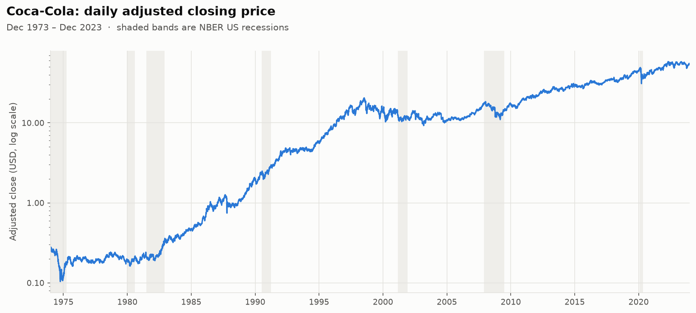

## Key results

<!-- RESULTS:START -->

_Sample: 31 Dec 1973 – 29 Dec 2023. Numbers below are regenerated by `python run_analysis.py`._

| Stylised fact | Supported? | Evidence |
|:--|:--:|:--|
| 1. Prices are non-stationary | ✅ | ADF on log price (constant + trend): stat -1.055, p = 0.936 |
| 2. Returns are stationary | ✅ | ADF on daily log-returns: stat -42.47, p < 0.0001 |
| 3. Returns are asymmetric (negatively skewed) | ✅ | Skewness daily -0.47, weekly -0.64, monthly -0.58, annual -1.11 |
| 4. Returns have heavy tails | ✅ | Daily kurtosis 20.0 (normal = 3); Jarque-Bera rejects normality |
| 5. Aggregational Gaussianity | ✅ | Kurtosis (worst obs. removed) falls from 10.4 daily to 3.2 annual; annual Lilliefors p = 0.21, Anderson-Darling A² = 0.506 < 0.740 (5% critical) |
| 6. Returns are not autocorrelated | ✅ | Daily lag-1 ACF +0.016; largest absolute lag-1 ACF at any frequency 0.081. Ljung-Box(40) p-values: daily ≤ 0.001, weekly 0.0042, monthly 0.213, annual 0.736 |
| 7. Volatility clustering | ✅ | Daily squared returns: 40/40 lags outside the band, Ljung-Box(40) = 3,493 (p < 0.0001) |
| 8. Leverage effect | ✅ | corr(down-month return, next-month vol) = -0.45; 12 of 20 lags of corr(r_(t-j), r_t²) significantly negative |

| Log-returns | daily | weekly | monthly | annual |
|:--|--:|--:|--:|--:|
| Mean (%) | 0.042 | 0.203 | 0.879 | 10.548 |
| Std. deviation (%) | 1.502 | 3.328 | 6.180 | 23.018 |
| Skewness | -0.469 | -0.643 | -0.579 | -1.106 |
| Kurtosis | 19.981 | 10.616 | 5.985 | 7.455 |
| Min (%) | -28.358 | -32.710 | -34.257 | -84.277 |
| Max (%) | 17.959 | 23.068 | 22.879 | 57.124 |
| Jarque-Bera p-value | < 0.0001 | < 0.0001 | < 0.0001 | < 0.0001 |
| Lilliefors p-value | ≤ 0.001 | ≤ 0.001 | ≤ 0.001 | 0.022 |
| Observations | 12,609 | 2,608 | 600 | 50 |

<!-- RESULTS:END -->

The full set of tables (all moments, quantiles, ADF / Jarque-Bera / Lilliefors / Anderson-Darling / Box-Pierce / Ljung-Box statistics) is in [`results/REPORT.md`](results/REPORT.md) and as CSVs in [`results/`](results/).

## The eight stylised facts

### 1 & 2: Prices are non-stationary, returns are stationary
Log prices sit on the 45° line against their own lag, and their ACF barely decays: this is the signature of a unit root.
An Augmented Dickey-Fuller test with constant and trend cannot reject it.
Differencing to log-returns removes it: returns fluctuate around a constant mean, and the ADF test (no deterministic terms, because returns have no trend and a near-zero mean) rejects the unit root decisively.

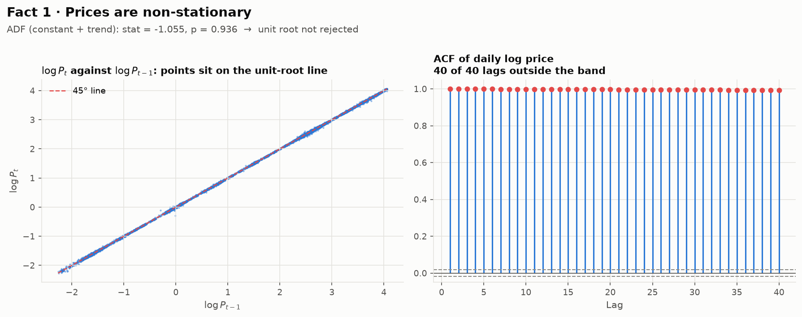
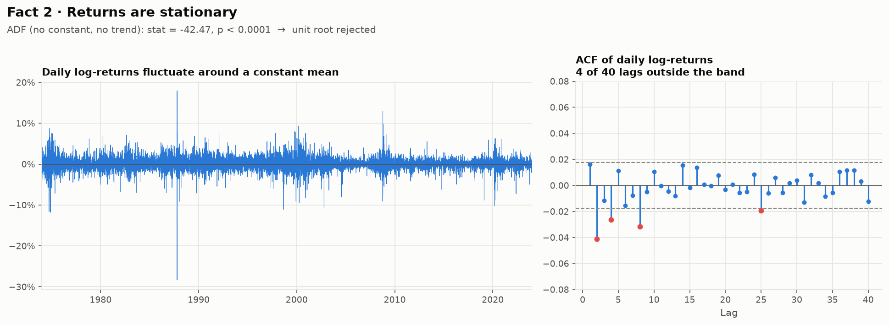

### 3: Returns are asymmetric
Skewness is negative at every frequency: crashes are sharper than rallies.
A large part of this comes from one day, the **19 October 1987 crash (a −28% daily log-return, about −25% in price)**.
The analysis is therefore repeated with the single most negative observation removed at each frequency.
After removal, weekly and monthly returns stay negatively skewed.

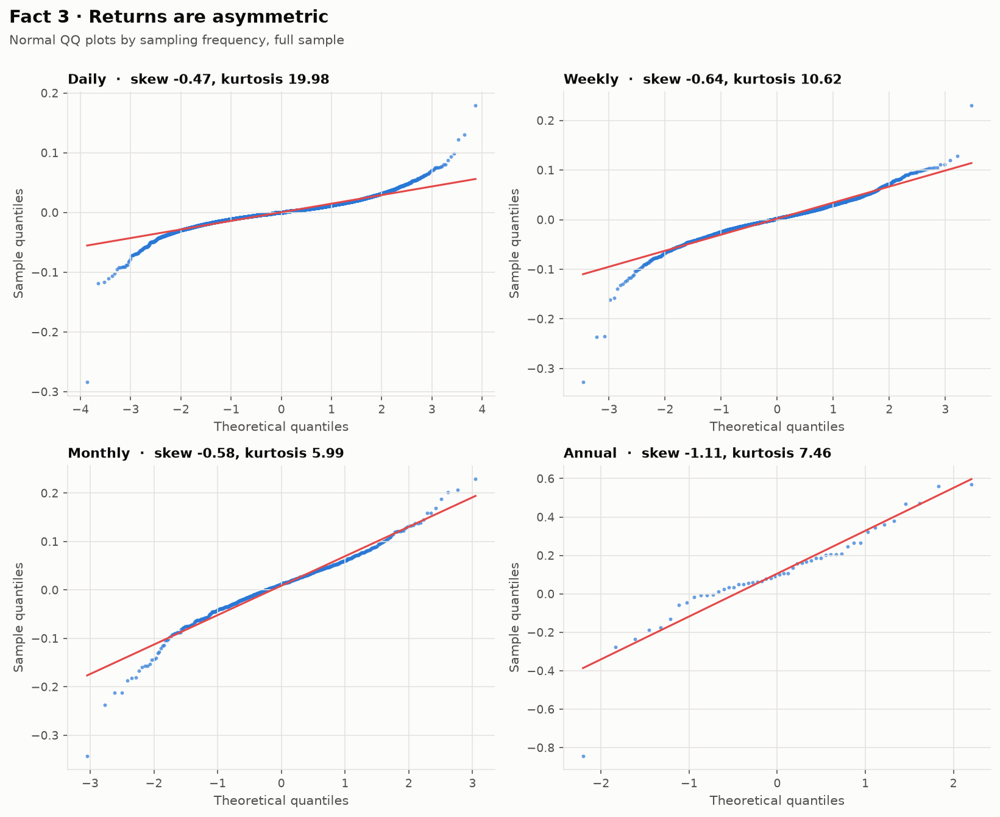
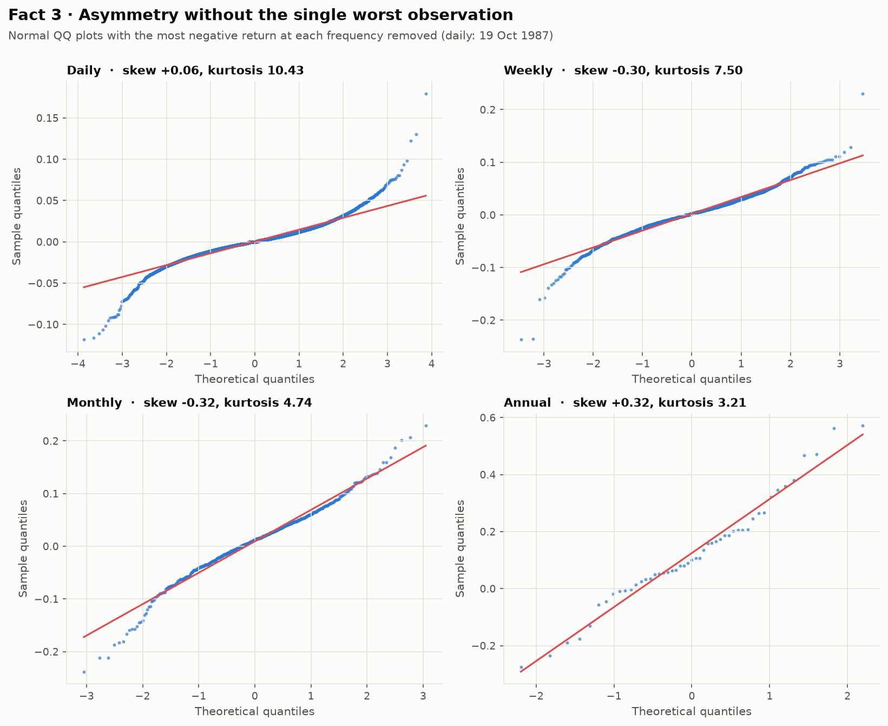

### 4: Heavy tails
Daily kurtosis is several times the normal value of 3.
Both tails bend away from the normal QQ line, and a Student-t distribution with only 3–5 degrees of freedom matches the data far better.

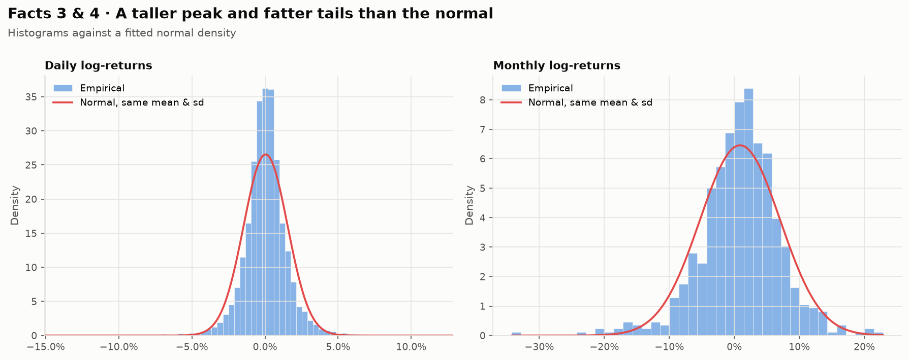
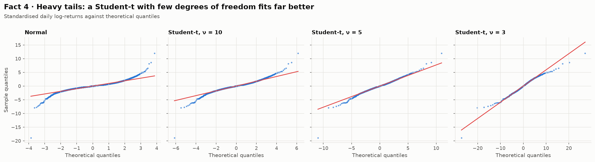

### 5: Aggregational Gaussianity
Summing daily returns into longer horizons pushes the distribution towards the normal, as the central limit theorem suggests.
Kurtosis falls steadily from daily to annual.
Lilliefors rejects normality of annual returns on the full sample (p ≈ 0.02).
Once the 1987 outlier is excluded, neither Lilliefors nor Anderson-Darling can reject it.

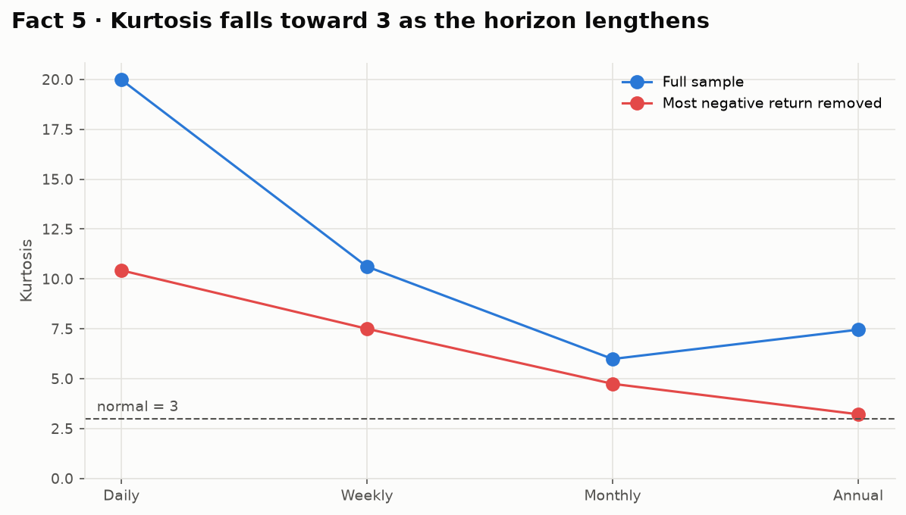
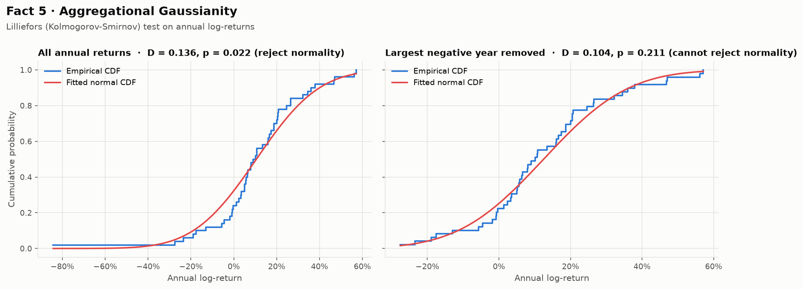

### 6: Returns are (almost) not autocorrelated
Sample autocorrelations are economically negligible: the daily lag-1 autocorrelation is about 0.02, far too small to trade on after costs.
With 12,600 daily observations, even tiny autocorrelations become statistically detectable.
Box-Pierce / Ljung-Box tests therefore reject white noise at the daily and weekly horizons, but not at the monthly or annual horizons.
The fact holds in the economic sense, not in the strict statistical one.

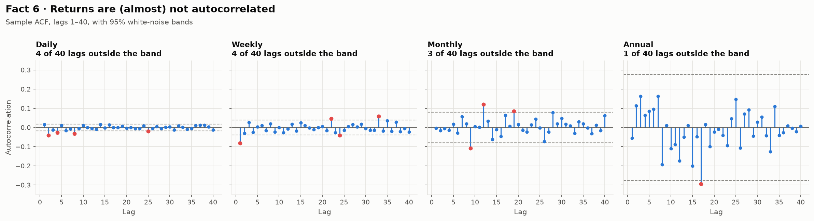

### 7: Volatility clustering
Squared returns are strongly and persistently autocorrelated at high frequency: calm periods follow calm periods and turbulent periods follow turbulent ones.
The effect fades as the horizon lengthens.
Rolling volatility peaks line up with 1987, the dot-com bust, the 2008 financial crisis and COVID-19.

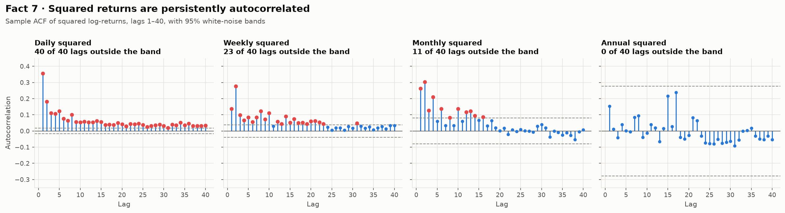
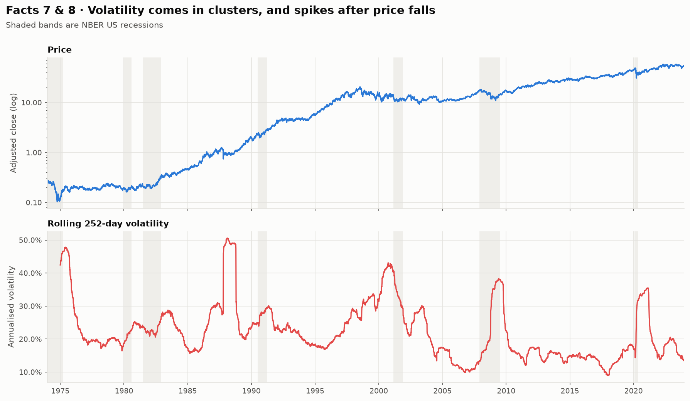

### 8: Leverage effect
Negative returns predict higher future volatility.
Two tests show it:
- Down months are followed by more volatile months.
- The cross-correlation between past returns and today's squared returns is significantly negative for most positive lags, and roughly zero for negative lags. The effect runs from returns to volatility, not the other way round.

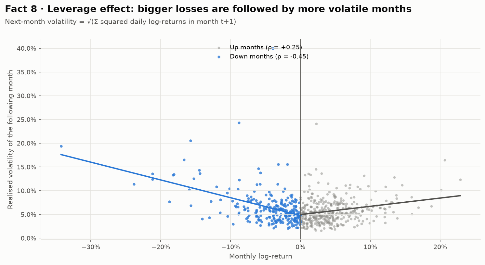
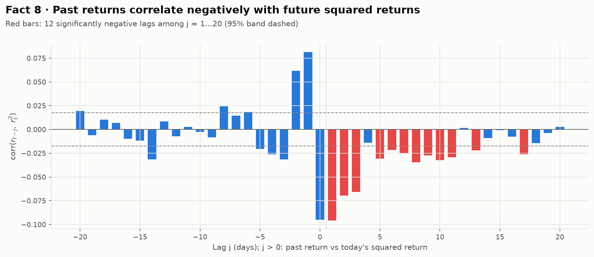

## Methodology

| Step | Choice |
|:--|:--|
| Data | Daily dividend- and split-adjusted closing prices from Yahoo Finance (`yfinance`), cached locally |
| Returns | Log-returns `r_t = ln P_t − ln P_(t−1)`; weekly (Friday close), monthly and annual returns built from end-of-period prices, so they aggregate exactly |
| Stationarity | Augmented Dickey-Fuller, lag length by AIC; constant + trend for prices, no deterministic terms for returns |
| Normality | Skewness, kurtosis, Jarque-Bera, Lilliefors (KS with estimated parameters), Anderson-Darling, QQ plots against normal and Student-t |
| Serial dependence | Sample ACF with Bartlett ±1.96/√n bands, Box-Pierce and Ljung-Box up to lag 40, for returns and squared returns |
| Leverage | Monthly return vs. **realised volatility of the following month** (√Σ squared daily returns); cross-correlation corr(r_(t−j), r_t²) for j = −20…20 |
| Robustness | Every distributional result is reported with and without the single most extreme negative observation |

## Project structure

```
├── run_analysis.py              # CLI entry point: data → tests → figures → report
├── src/stylised_facts/
│   ├── data.py                  # Yahoo Finance download, CSV cache, CSV import
│   ├── returns.py               # log-returns at daily/weekly/monthly/annual frequency
│   ├── stats.py                 # summary stats and all hypothesis tests
│   ├── plots.py                 # one function per figure, consistent styling
│   └── analysis.py              # pipeline, verdicts, Markdown report, README update
├── tests/                       # pytest suite (runs offline on a simulated GJR-GARCH-t process)
├── figures/                     # generated charts
├── results/                     # generated CSV tables and REPORT.md
└── .github/workflows/           # CI: unit tests + automated re-run of the analysis
```

## Getting started

```bash
git clone https://github.com/michielkuhn/financial-econometrics-stylized-facts.git
cd financial-econometrics-stylized-facts
pip install -r requirements.txt

python run_analysis.py                        # Coca-Cola 1973–2023 (default)
python run_analysis.py --ticker SPY --name "S&P 500 ETF" --start 1994-01-01 --end 2024-12-31 --no-readme
python run_analysis.py --csv prices.csv       # offline: any CSV with Date + Adj Close columns

pytest                                        # run the test suite
```

The test suite does not need internet access.
It simulates a GJR-GARCH(1,1) process with Student-t shocks, which has heavy tails, volatility clustering and a leverage effect built in.
It then checks that the estimators detect those features, and that the whole pipeline produces every figure and table.

## Improvements over the original coursework version

This started as a university group project in financial econometrics (2024), written as a single Jupyter notebook.
Refactoring it into this package also meant auditing the statistics:

- **Kurtosis label fixed.** `scipy.stats.kurtosis` returns *excess* kurtosis by default. The original table reported it as kurtosis and then subtracted 3 again. Both are now computed correctly.
- **Real Lilliefors test.** The column labelled "Lilliefors" actually contained ADF statistics. It now uses `statsmodels`' Lilliefors test.
- **Leverage measure without look-ahead overlap.** Next-month volatility was a 2-month rolling standard deviation that *included the month's own return*, which mechanically produces a negative correlation. It is replaced by realised volatility computed only from the following month's daily returns.
- **No dual-axis charts.** Price and volatility are shown as aligned panels instead of two y-scales on one plot.
- **Reproducibility.** One cached download instead of five repeated ones, parameters via CLI, unit tests, and CI that regenerates every figure.

## License

[MIT](LICENSE)
